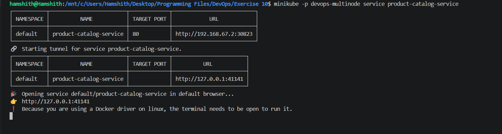
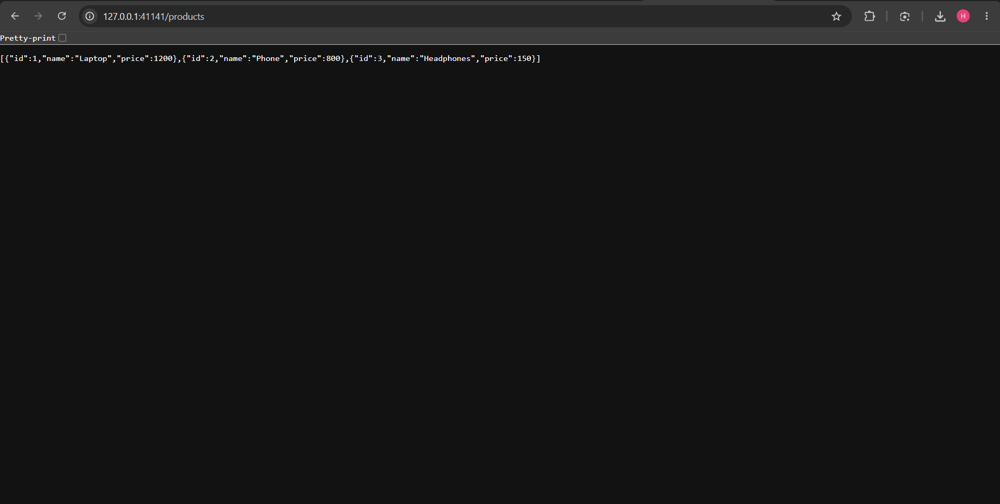
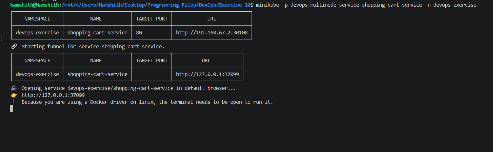
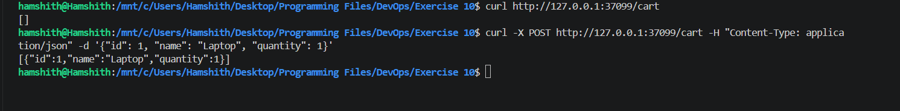

# Exercise 10

## Minikube Setup

Run the following command to setup minikube :

```bash
minikube start --nodes 3 -p devops-multinode --force
```

Run the following command to setup minikube with multiple node :

```bash
minikube -p devops-multinode addons enable registry
```

## Application setup

1. Create and have the code in the product_catalog.py and shopping_cart.py
2. Create Dockerfiles to containerize the above applications named as Dockerfile.product and Dockerfile.shopping

## Build the docker images using the following commands :

```bash
docker build -t product-catalog:latest -f Dockerfile.product .
docker build -t shopping-cart:latest -f Dockerfile.shopping .
```

## Load the built images into the registry using the following commands :

```bash
minikube -p devops-multinode image load product-catalog:latest
minikube -p devops-multinode image load shopping-cart:latest
```

Verify that the images are loaded using the following command :

```bash
minikube -p devops-multinode ssh -- docker images
```

## Deploy the applications on minikube

Create the deployement files product_catalog_deployment.yaml and shopping_cart_deployment.yaml

Create namespace using the following command

```bash
kubectl create namespace devops-exercise
```

And run the following commands to apply the configurations :

```bash
kubectl apply -f product_catalog_deployment.yaml
kubectl apply -f shopping_cart_deployment.yaml
```

## Expose the services 

Create the service files product_catalog_service.yaml and shopping_cart_service.yaml

And run the following commands to apply the services :

```bash
kubectl apply -f product_catalog_service.yaml
kubectl apply -f shopping_cart_service.yaml
```

## Access product service using the following command :

```bash
minikube -p devops-multinode service product-catalog-service
```

## Screenshots



---



---



---

