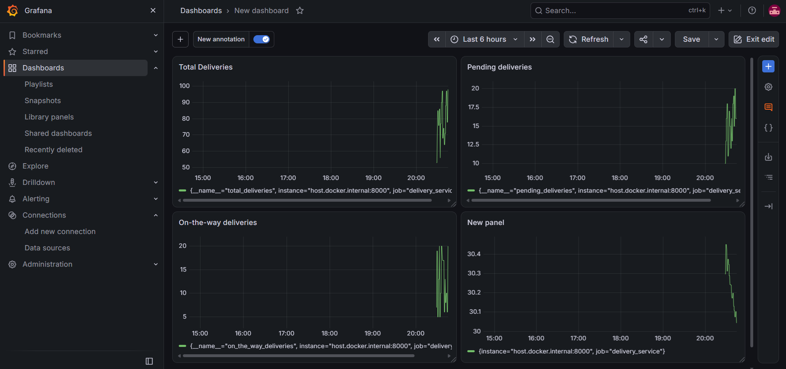

# Exercise 6

Use WSL for this exercise

## Install prometheus package for python into a virtual environment

```bash
python3 -m venv venv
source venv/bin/activate
python -m pip install prometheus-client
```
## Create a file structure as following

```
delivery_monitoring/
├── delivery_metrics.py   # Python script to simulate metrics
├── prometheus.yml        # Prometheus configuration
├── alerts_rules.yml      # Alerts configuration
├── Jenkinsfile           # Jenkins pipeline script

```
Change the directory using the following commmand :

```bash
cd delivery_monitoring
```
## Run the delivery_metrics.py file using the following command :

```bash
python delivery_metrics.py
```

The metrics log can be accessed in the following link :  http://localhost:8000/metrics

## Configure prometheus in the prometheus.yml  and alerts_rules.yml file and run it using the following command :

Create a network for prometheus and grafana
```bash
docker network create monitoring
```
Create docker container : 
```bash
docker run -d \
  --name prometheus \
  --network monitoring \
  -p 9090:9090 \
  -v "$(pwd)/prometheus.yml:/etc/prometheus/prometheus.yml:ro" \
  -v "$(pwd)/alert_rules.yml:/etc/prometheus/alert_rules.yml:ro" \
  prom/prometheus
```
Prometheus can be viewed at this link : http://localhost:9090/query

## Run Grafana on docker using the following command : 
```bash
docker run -d \
  --name grafana \
  --network monitoring \
  -p 3000:3000 \
  grafana/grafana
```

Access grafana at http://localhost:3000/
Use the folloowing credentials :
Username : admin
password : admin

## Connect Grafana to Prometheus
In Grafana:
1. Navigate to Connections → Data sources.
2. Add a Prometheus data source.
3. Set the URL to http://prometheus:9090.
4. Select Save & test.

## Create a dashboard with these queries:
Panel	                PromQL query
Total deliveries	    total_deliveries
Pending deliveries	    pending_deliveries
On-the-way deliveries	on_the_way_deliveries
Average delivery time	average_delivery_time_sum / average_delivery_time_count

## Create Jenkins Pipeline :

### Run Jenkins using the following command :

```bash
docker run -d \
  --name jenkins \
  -p 8080:8080 \
  -p 50000:50000 \
  -v jenkins_home:/var/jenkins_home \
  jenkins/jenkins:lts
```

Get the initial administrator password using the following command :.

```bash
docker exec jenkins cat /var/jenkins_home/secrets/initialAdminPassword
```

### Create the Jenkinsfile

## Screenshots

 


