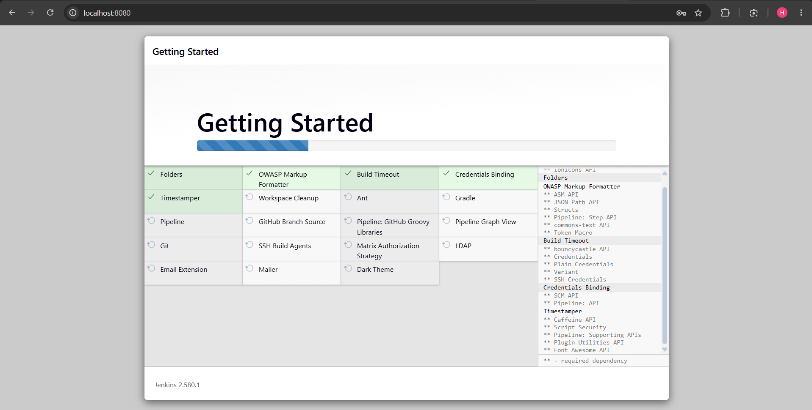
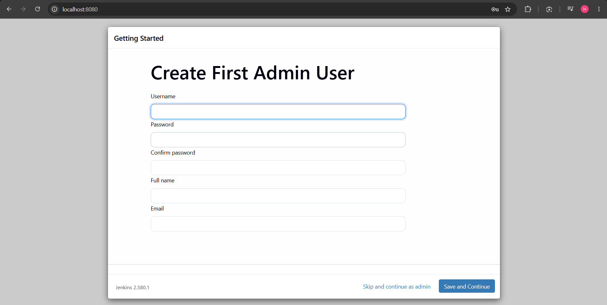
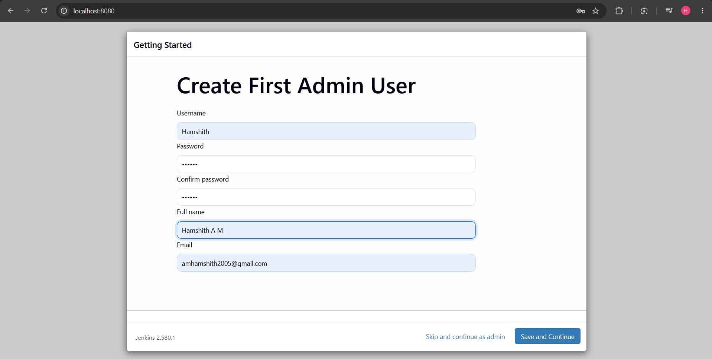
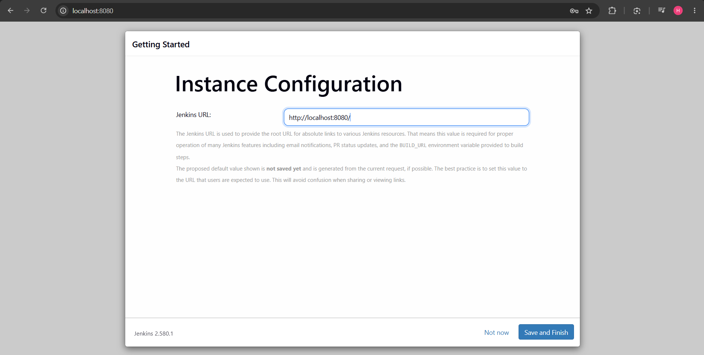
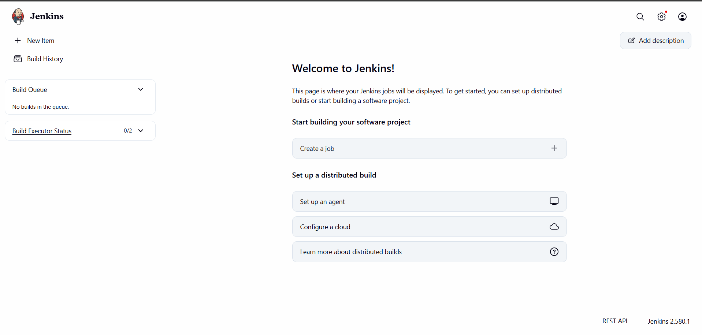

# Exercise 7: Introduction to CI and Jenkins

## 1. Run Jenkins Using Docker

```bash
docker run -d \
  --name jenkins \
  -p 8080:8080 \
  -p 50000:50000 \
  jenkins/jenkins:lts
```

Check whether the container is running:

```bash
docker ps -a
```

## 2. Retrieve the Initial Admin Password

```bash
docker exec jenkins cat /var/jenkins_home/secrets/initialAdminPassword
```

## 3. Access Jenkins

Use the following link to access Jenkins :
http://localhost:8080/

Complete the initial setup:

1. Enter the initial administrator password.
2. Install the suggested plugins.
3. Create an administrator user.
4. Confirm the Jenkins URL and finish the setup.

## Screenshots










